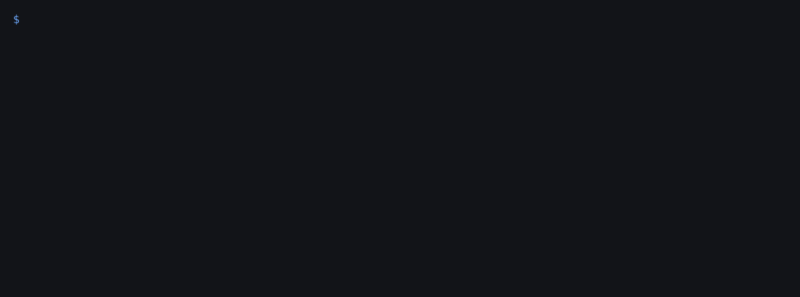

# wallet-alert

Watch Base wallets. Every time a new token lands in one of them, get an alert with a rug check:
can it be sold, who controls it, has the deployer rugged before.



The GIF replays a real run on Base (2026-11-06, output saved in `docs/real_run_2026-11-06.txt`).
The second alert is a new coin whose deployer already rugged an earlier token: grade C, "trade small or skip".

## Run it

One file, Python 3.9+, standard library only. No account or key to start.

```sh
git clone https://github.com/cyberwarex/wallet-alert && cd wallet-alert
python3 wallet_alert.py --wallet 0xYourWallet=me --wallet 0xSomeWhale=whale
```

It polls every 30 seconds and prints alerts. To get them in Telegram, make a bot with @BotFather and set:

```sh
export TG_BOT_TOKEN=123:abc TG_CHAT_ID=your_chat_id
```

What an alert looks like:

```
trader-1 received 768,861 GM
Rug check: CAUTION (LIMIT, grade C, risk 35/100)
Why: material risk found; trade small or skip: deployer_prior_rug, no_effective_controllers, scam_signals_incomplete
Flags: DEPLOYER_PRIOR_RUG, DEPLOYER_REPUTATION_FLOOR, NO_EFFECTIVE_CONTROLLERS, SCAM_SIGNALS_INCOMPLETE
Token: https://basescan.org/token/0xbe4eecc9b85f76558982d196765f705c912b9ba0
Tx: https://basescan.org/tx/0xd951c30187e8aee319837488475e05762d1387c00663e44d59f5490c658ca47a
```

## Options

| flag | default | what it does |
|---|---|---|
| `--wallet 0x..=label` | | wallet to watch, repeat for more |
| `--interval` | 30 | seconds between polls |
| `--once` | | poll one time and exit (good for cron) |
| `--every` | | alert on every transfer, not only the first time a token shows up |
| `--hide-blocked` | | count BLOCK-grade junk airdrops in one line instead of one alert each |
| `--rpc` | Tenderly public Base gateway | your own Base RPC (or `BASE_RPC`) |
| `--lookback` | 900 | blocks to scan on first start (Base makes 5 blocks a second) |
| `--state` | `wallet_alert_state.json` | where the cursor and cached verdicts live |

## Where the rug check comes from

Each new token goes to the [CyberWareX safety oracle](https://oracle.cyberwarex.com) (`/risk/explain`).
It simulates a real buy and sell on the token's pool, reads who can mint, pause, blacklist or upgrade it,
and looks up the deployer's earlier tokens. Answer: ALLOW, LIMIT, RECHECK or BLOCK, a grade A to F and reason codes.

- 3 checks per IP per day are free.
- After that, alerts still arrive but say `NOT CHECKED ... treat as unknown, not safe`. A token is never shown as safe without a check.
- To keep checking, set `CWX_KEY` to a prepaid key: pay once with any x402 client,
  `POST https://safe.cyberwarex.com/subscribe?usd=3` ($3 gives $3.30 of credit, about 600 checks at $0.005).
- Each token is checked once and cached for 24 hours, so a busy wallet does not burn checks.

Automated heuristics, not financial advice.

## Limits, said plainly

- Base only for now (the oracle also covers BSC, Ethereum, Polygon, Arbitrum; the watcher does not yet).
- ERC-20 only. NFTs and native ETH transfers are skipped.
- The keyless RPC answers 1000 blocks per query; after a long stop the watcher skips ahead (`--max-catchup`)
  instead of replaying hours of history.
- At most 20 alerts per poll; the rest are counted in one line.

## Tests

```sh
python3 -m unittest -v
```

All network calls are stubbed in the tests.

## Want it hosted, or built for your case?

We are testing whether people want this as a hosted service (your wallets, your Telegram, plus actions like
auto-revoke or a sell alert). If you would use that, open a
[build request](https://github.com/cyberwarex/wallet-alert/issues/new?template=build-request.md)
with what you need and a rough budget, or leave a contact and budget on the short form at
[cyberwarex.com/gigs](https://cyberwarex.com/gigs) if you have no GitHub account. No promise yet; we count the requests to decide what to build.

Sister demos: [token-check-bot](https://github.com/cyberwarex/token-check-bot) answers every token address posted in your Telegram group with the same rug check; [daily-token-report](https://github.com/cyberwarex/daily-token-report) re-checks a token list once a day and reports what changed.

MIT license.
